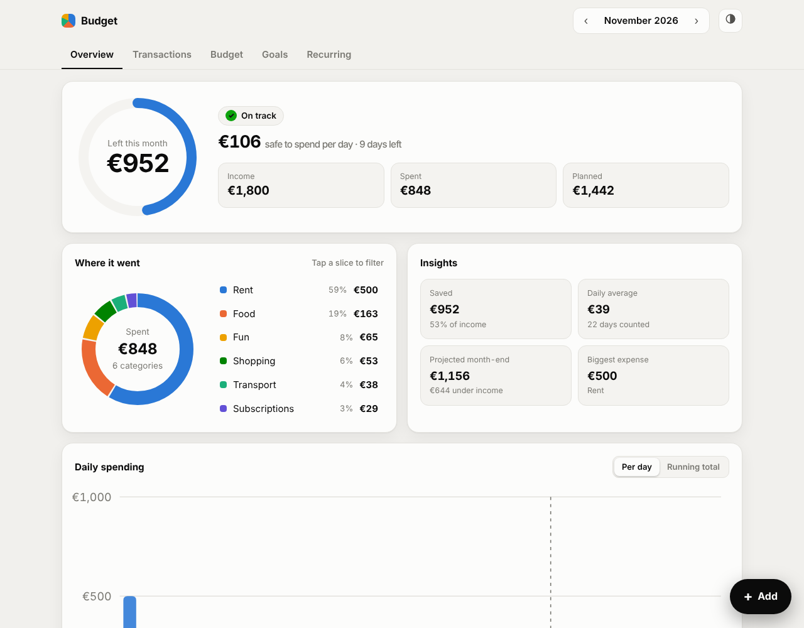
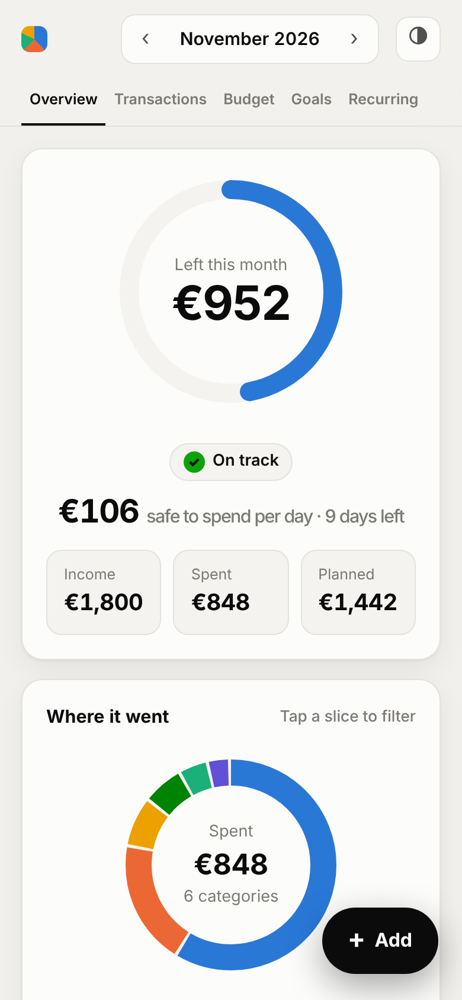
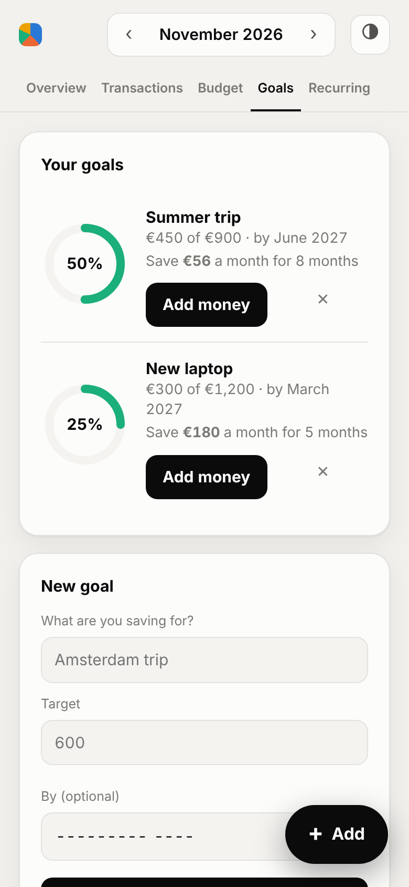
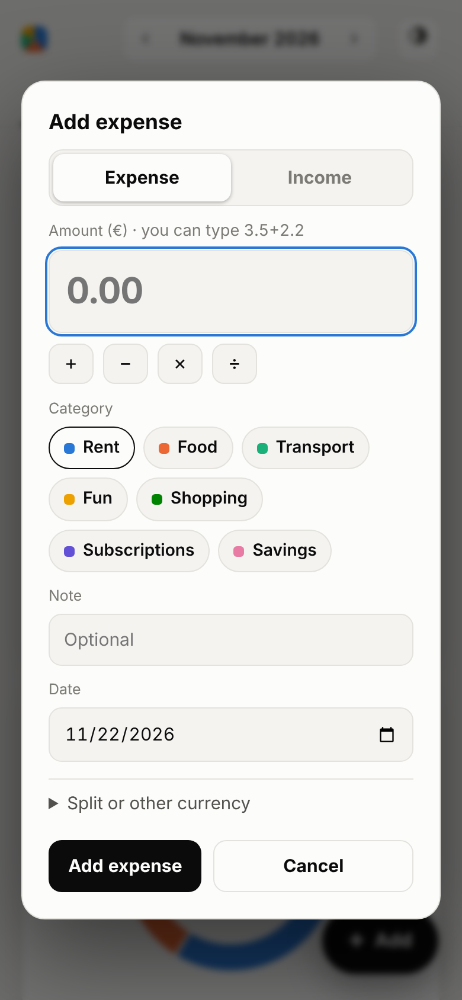
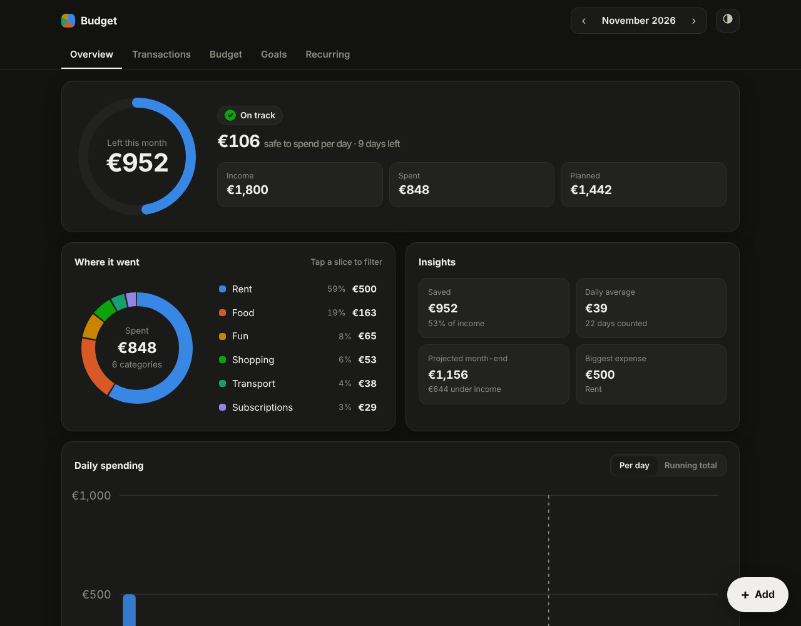

# Budget

[](https://github.com/MitsoMinh/budget-app/actions/workflows/test.yml)
[](https://mitsominh.github.io/budget-app/)
[](LICENSE)

A free, private monthly budgeting app. **It works on PC and on iPhone (tested on a real iPhone)**, and it installs as an app on Android too. There's no account, no server, and no tracking: your data stays on your device.

**Try it:** https://mitsominh.github.io/budget-app/

<p align="center">
  
</p>

<p align="center">
  
  
  
  
</p>

*Screenshots use made-up demo data.*

## Features
- **Overview:** spending ring, safe-to-spend per day, category donut, daily chart, 6-month trend, weekday pattern
- **Budget planner:** sliders per category, income, and rollover of unspent money
- **Fast entry:** one-tap quick-add chips, calculator-style amounts (`3.5+2.2`), remembered category
- **Savings goals** with a monthly target, **recurring items**, **expense splitting**, **multi-currency**
- **Insights:** change versus last month and "on pace to overspend" warnings
- Search, CSV export, JSON backup and restore, light and dark theme
- Swipe to delete and pull to refresh on phones, works offline

## Install on your phone
- **iPhone (works, tested):** open the link in Safari, tap Share, then **Add to Home Screen**. Open it from the home screen icon afterwards.
- **Android:** open the link in Chrome, tap the menu, then **Install app**. This uses the same web app, but I haven't tested it on a real Android phone yet.
- **PC:** just open the link in Chrome or Edge. Optionally install it from the address bar.

Each device keeps its own data. Use **Budget > Save backup** to keep a copy or to move data between devices.

## Project layout
| File | Purpose |
|---|---|
| `index.html` | Page shell |
| `style.css` | Design tokens and styles |
| `lib.js` | Pure money logic, no DOM, unit tested |
| `app.js` | UI and events |
| `sw.js`, `manifest.json`, icons | Offline support and install |
| `tests/lib.test.js` | Automated tests |

## Develop
```
node tests/lib.test.js        # run the tests, no dependencies
python3 -m http.server 8000   # then open http://localhost:8000
```
When you change cached files, bump `CACHE` in `sw.js`. Tests also run on every push via GitHub Actions.

## Deploy
GitHub Pages: Settings > Pages > Deploy from branch `main`, folder `/ (root)`.

## Roadmap
- Accounts and a "does it add up?" check, with transfers between your own accounts
- CSV import from bank statements
- A "paid back" option for money friends owe you
- Recurring items with an end date, and a "4th working day" salary option
- Cloud sync across devices (needs a backend account, so it's not built yet)

## Known limits
It hasn't been tested on a real Android phone yet. Data is stored in the browser's local storage, so clearing site data deletes it. Save backups regularly.

## Build your own
Ask Claude: "Build a single-page PWA monthly budgeting app in vanilla JS (no frameworks), localStorage, hand-written SVG charts, light/dark theme, recurring items, savings goals, rollover, splitting, backups, phone-friendly, hosted on GitHub Pages. Keep the money logic in a separate tested module."

## License
MIT. See [LICENSE](LICENSE).
